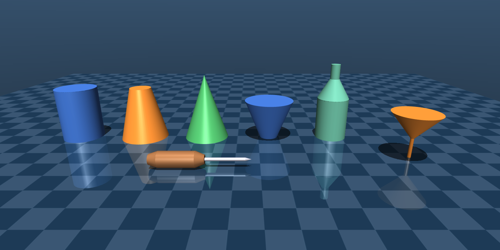
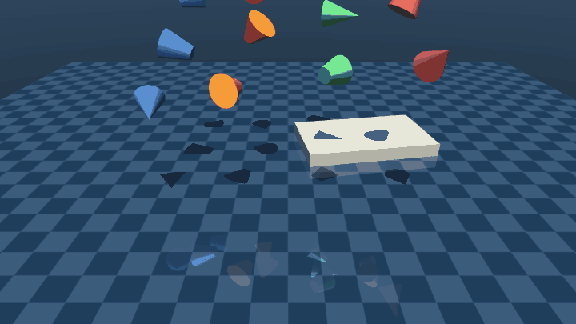

# Cones and conical frustums

A [cone](https://mujoco.readthedocs.io/en/latest/XMLreference.html#body-geom-cone) geom is a cone
or a conical frustum: `size="radius-bottom half-height radius-top"`, where the radius at the +Z
end defaults to 0, or `size="radius-from radius-to"` when the geom is given by `fromto`, where the
radius at the "to" point defaults to 0.

  
  

| Model | Description |
| --- | --- |
| [`gallery.xml`](gallery.xml) | A cylinder, frustums and a cone, and objects built from them: a bottle, a screwdriver and a funnel. |
| [`falling.xml`](falling.xml) | Cones and frustums falling onto a plane and a box, coming to rest or rolling. |
| [`contacts.xml`](contacts.xml) | Frustums and cones resting on a plane, a box and on each other, with contacts visualized. |
