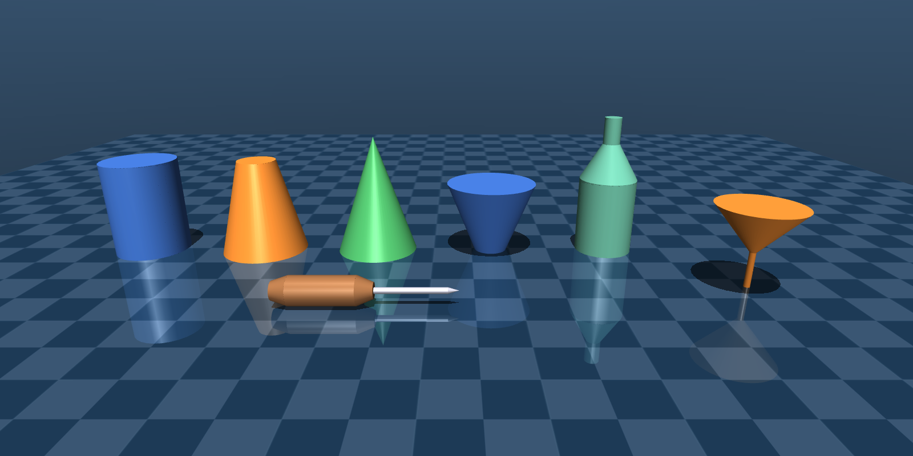
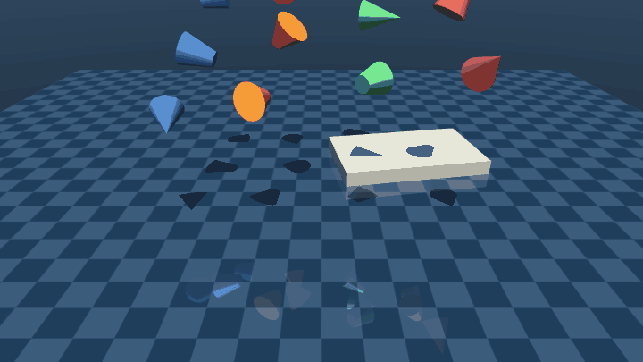

# Conical frustums and cones

A [cylinder](https://mujoco.readthedocs.io/en/latest/XMLreference.html#body-geom-type) geom
becomes a conical frustum when its radii at the two ends differ, and a cone when one of them is 0.
The radius at the -Z end is the optional third size parameter, `size="radius half-height radius2"`,
or the second one when the geom is given by `fromto`, `size="radius_from radius_to"`.

  
  

| Model | Description |
| --- | --- |
| [`gallery.xml`](gallery.xml) | A cylinder, frustums and a cone, and objects built from them: a bottle, a screwdriver and a funnel. |
| [`falling.xml`](falling.xml) | Cones and frustums falling onto a plane and a box, coming to rest or rolling. |
| [`contacts.xml`](contacts.xml) | Frustums and cones resting on a plane, a box and on each other, with contacts visualized. |
